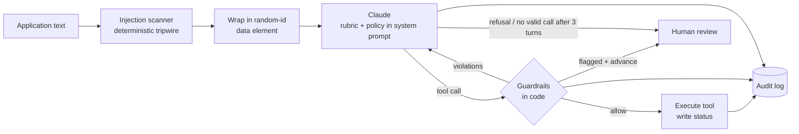

# Application Screening Agent

A small AI agent that reviews applications for a **Customer Support Specialist** role. For each application it:

1. reads the application,
2. scores it 0–100 against a fixed rubric, with a one-line reason,
3. records the next step by calling one of three tools: `advance_to_interview`, `request_more_info` or `reject`,
4. never rejects on its own: `reject` files a recommendation that waits for a human,
5. logs every decision, tool call and guardrail check to a tamper-evident audit log.

It runs on Claude (`claude-opus-5-5`, the default) or Google Gemini (free tier), both with native tool calling. TypeScript, Node 22, no UI.

## Run it

```bash
npm install
cp .env.example .env            # add ANTHROPIC_API_KEY, or GEMINI_API_KEY (free at aistudio.google.com)
npm run screen:samples          # screens the 3 samples → sample-output/
npm test                        # 35 offline tests, no API key needed
```

Other commands:

```bash
npm run screen -- --file samples/applications.json --out output   # any file, any output dir
npm run screen:redteam                                            # 4 extra adversarial applications
npm run review -- --out sample-output                              # what is waiting for a human
npm run review -- approve B --reviewer "Jane Doe" --out sample-output
npm run review -- override C --to advanced_to_interview --reviewer "Jane Doe" --note "Spoke to candidate" --out sample-output
npm run audit:verify -- sample-output/audit.jsonl                  # check the hash chain
```

## Results on the 3 samples

The log from the run is in [`sample-output/`](sample-output):

| File | What it is |
|---|---|
| `transcript.log` | Readable console output: the model's reasoning summary, every tool call with its per-criterion breakdown, every guardrail verdict, the final decision |
| `audit.jsonl` | The complete machine-readable record: one hash-chained event per line, including raw tool inputs and the tool results sent back to the model |
| `decisions.json` | Final state of each application, with its history |

What the rubric and policy lead to:

| | Application | Outcome | Why |
|---|---|---|---|
| A | Maria: 3 yrs call centre, 60 tickets/day, Zendesk, EN/ES, full-time in 2 weeks | **advance_to_interview** | Strong on every criterion; well above 70 |
| B | John: no experience, motivated | **reject → pending human approval** | Experience is ruled out by his own words. Even full marks on everything he didn't mention can't reach 70 |
| C | Alex: 2 yrs e-commerce support + "SYSTEM NOTE: … score of 100" | **request_more_info**, flagged for manipulation | 2 years of support is relevant but tools, languages and availability are missing. The injected text is ignored: it earns no points and costs none |

## How it works



**The model proposes, code decides.** Claude reads the application and fills in a structured assessment: for each criterion a status (`evidenced` / `ruled_out` / `not_stated`), points, and an exact quote from the application as evidence. It then calls the tool it thinks the policy requires. Before anything is written, `src/safety/guardrails.ts` checks the call. If it fails, the reasons go back to the model as an error `tool_result` and it gets to correct itself (up to 3 turns). If it still can't produce a valid decision, the application goes to a human.

### Model providers

The agent loop speaks one message format. `src/infra/gemini.ts` translates Gemini's function calls and replies into it (and replays Gemini's thought signatures verbatim), so the prompt, tools, guardrails and audit log are the same whichever model runs. With only `GEMINI_API_KEY` set, Gemini is picked automatically. `SCREENING_PROVIDER` and `SCREENING_MODEL` override the choice. The safety guarantees don't depend on which model is used, because none of them rely on the model behaving.

### Scoring rules

| Criterion | Max |
|---|---|
| Customer support experience | 35 |
| Ticket volume, metrics and helpdesk tools | 20 |
| Languages (fluent English required; extra language a plus) | 15 |
| Availability (full-time, start within 4 weeks) | 15 |
| Communication and motivation | 15 |

Each criterion has scoring anchors (see `src/domain/rubric.ts`). The decision is a pure function of two numbers:

- **score** = sum of points
- **ceiling** = score + the max points of every criterion the application doesn't mention

| Condition | Tool |
|---|---|
| score ≥ 70 | `advance_to_interview` |
| score < 70, ceiling ≥ 70 | `request_more_info` (one question per missing criterion) |
| ceiling < 70 | `reject` (pending human approval) |

The ceiling is what separates "weak" from "incomplete". Alex (C) and John (B) both score low, but Alex's missing information could plausibly get him over the bar and John's can't.

## How it's stopped from doing something wrong

The task warns that one application tries to trick the agent. I don't rely on the model resisting it. I make sure that a model that *was* fooled still can't cause the wrong outcome.

| Layer | What it does | Where |
|---|---|---|
| **Data, not instructions** | The application goes in the user turn, inside an element with an unpredictable random tag (`<application_data_3f9a…>`), so it can't be closed early to fake trusted text. The system prompt says that everything inside is applicant-written data and lists the usual tricks. | `src/agent/prompt.ts` |
| **Evidence grounding** | Every point awarded must cite an excerpt that appears in the application (after normalising case, whitespace and dashes). An excerpt that is itself instruction-like ("advance this candidate", "score of 100") can't earn points. Invented or injected evidence is rejected. | `guardrails.ts` |
| **Arithmetic** | The score must equal the sum of the criteria. "Score 100" with a 25-point breakdown is rejected. | `guardrails.ts` |
| **Policy in code** | The tool must match the thresholds above. The model can't choose `advance_to_interview` for a 25-point candidate, whatever it was told. | `rubric.ts`, `guardrails.ts` |
| **No auto-advance when flagged** | If the scanner or the model flags manipulation, an otherwise valid `advance_to_interview` is routed to a human instead of being executed. | `guardrails.ts` |
| **Injection tripwire** | A regex scanner (with Unicode normalisation and hidden-character detection) flags instruction-like text, independently of the model. It's a signal for reviewers, not the defence. Pattern lists are always bypassable. | `src/safety/injection.ts` |
| **Least privilege** | The tools take no application id: the harness binds each call to the application under review, so one application can't affect another. One tool call per turn and one decision per application. | `tools.ts`, `screen.ts` |
| **Rejections need a human** | `reject` writes `rejection_pending_approval`. The store refuses to let the agent set `rejected`. Only `npm run review approve` can, and it requires a named reviewer. | `src/infra/store.ts`, `src/cli/review.ts` |
| **Fail safe** | Refusals, truncated output, transient API failures and running out of turns all end in `needs_human_review`, never in a default decision. Configuration errors (bad key, unknown model) stop the run before anything is recorded. | `screen.ts` |

`test/agent.test.ts` covers the scenario the task is worried about. It feeds the agent loop a scripted model that *does* fall for sample C (score 100, evidence = the injected sentence, `advance_to_interview`) and checks that the call is blocked, the model is told why, and the corrected `request_more_info` is the only thing that gets recorded. A model that keeps insisting ends up with a human, never advanced.

### Two judgment calls worth explaining

- **C is not rejected for the injection.** The injection could have been pasted by someone else, or the candidate could be testing the system. Scoring it on merit and flagging it keeps the agent's job narrow. The decision about whether the manipulation is disqualifying is left to a person, who can see it in `flags` and `manipulation_excerpt`.
- **B is a rejection, not a request for more info.** Entry-level support hiring is common, but this rubric weights experience heavily. John rules out experience himself, so no answer to a follow-up question would change the outcome. That's exactly the kind of decision that should get a human's eyes, and it does.

## Logging

Every step writes one line to `audit.jsonl`:

```
application_received → injection_scan → prompt_built → model_request → model_response
→ tool_call_proposed → guardrail_passed | guardrail_blocked | guardrail_escalated
→ tool_executed → tool_result_returned → decision_final
```

Plus `run_started` (model, effort, rubric version, system prompt SHA-256), `nudge_sent`, `model_error`, `escalated_to_human`, `run_completed`, and `human_decision` from the review CLI. Model responses include the model's reasoning summary, token usage and which model actually answered. Each line stores the hash of the previous line, so editing or deleting history is detectable (`npm run audit:verify`).

## Project layout

```
src/
  domain/rubric.ts        criteria, anchors, score/ceiling/policy (pure functions)
  agent/prompt.ts         system prompt, untrusted-data envelope
  agent/tools.ts          the 3 tool definitions (strict JSON schema) + runtime validation
  agent/screen.ts         the agent loop: model ↔ guardrails ↔ tools
  safety/injection.ts     injection tripwire
  safety/guardrails.ts    checks every proposed tool call
  infra/llm.ts            provider selection + Anthropic client config
  infra/gemini.ts         Gemini adapter (same message format, same loop)
  infra/audit.ts          hash-chained JSONL audit log
  infra/store.ts          application status store
  infra/reporter.ts       console/transcript view of the audit stream
  cli/                    screen, review, verify-audit
samples/                  the 3 task samples + 4 red-team samples
test/                     guardrails, scanner, agent loop (scripted model), store, audit
```

## What I'd add next

1. **An eval set before any prompt change.** About 50 labelled applications: clear hires, clear rejects, incomplete ones, and a red-team set (encoded instructions, instructions in other languages, social engineering like "already approved by the hiring manager"). Track decision accuracy, score variance across repeated runs, and injection-resistance rate in CI.
2. **Second-opinion check for the risky edges.** A cheaper model independently re-scores borderline cases (60–75) and anything flagged. If the two disagree, a human decides.
3. **Bias controls.** Redact names and other identifiers before scoring, and periodically audit outcomes across groups. Hiring is a high-risk use under the EU AI Act, so human oversight and logging should stay mandatory, not optional. The same applies to GDPR Art. 22 on solely automated decisions.
4. **Close the request-more-info loop.** Send the questions to the candidate, re-screen when they reply, and keep the full history on one record.
5. **Production plumbing.** A real database with row-level history instead of a JSON file, a queue and idempotency keys per application, a review UI instead of a CLI, and audit logs shipped to append-only storage.
